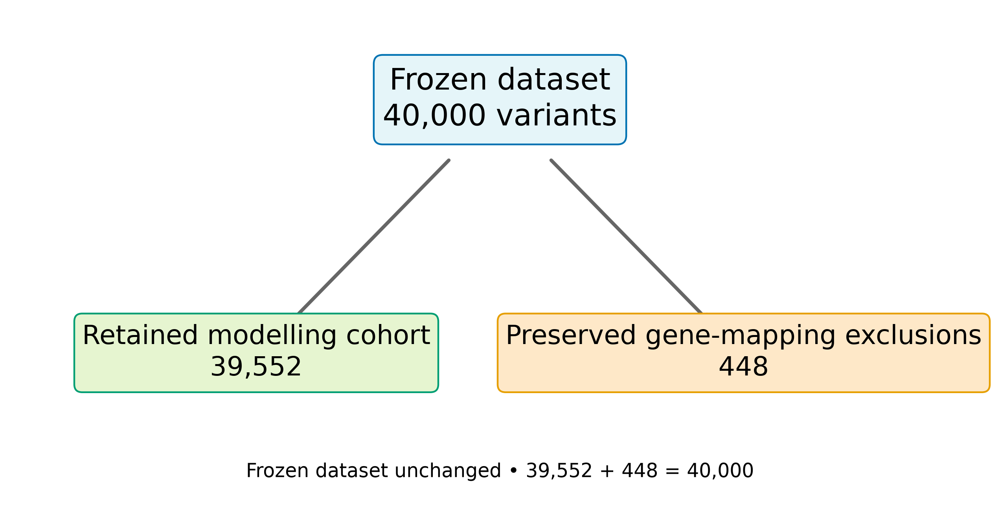
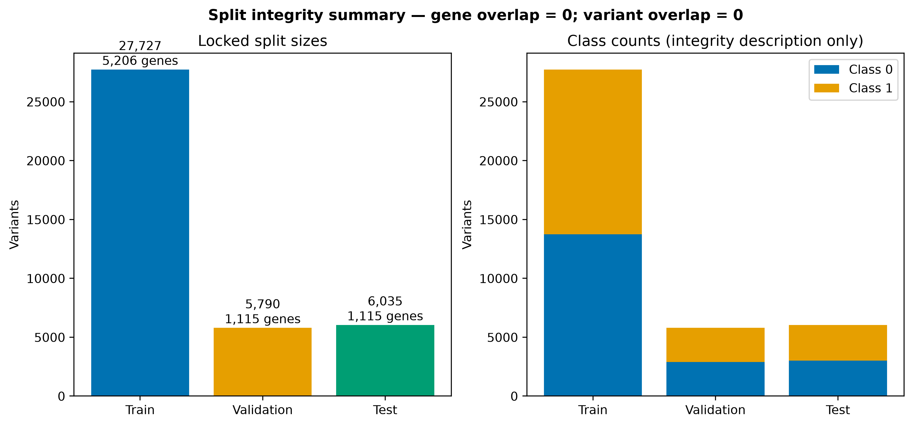
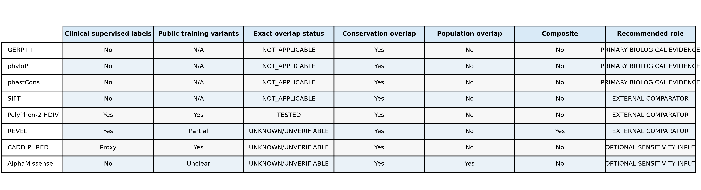
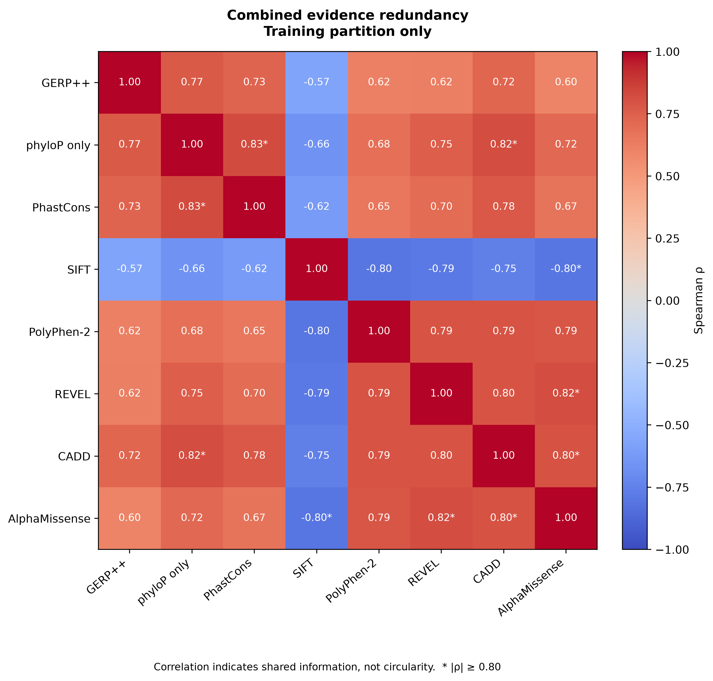
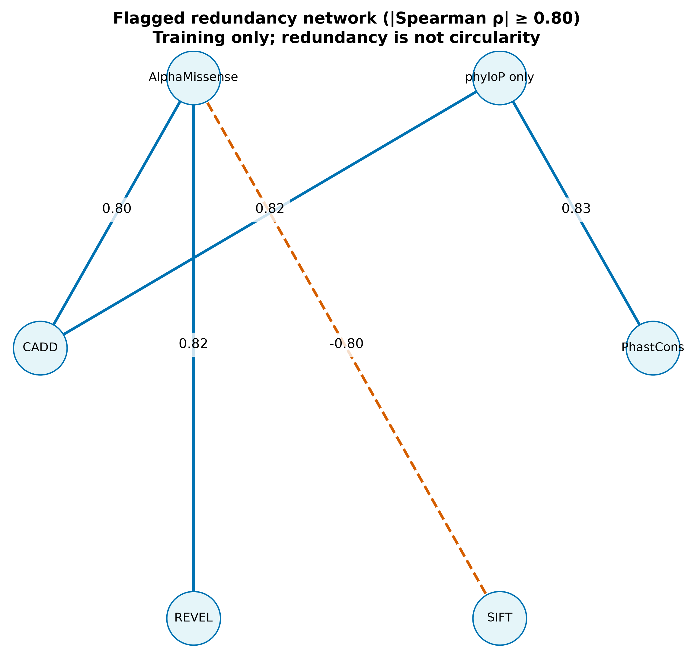
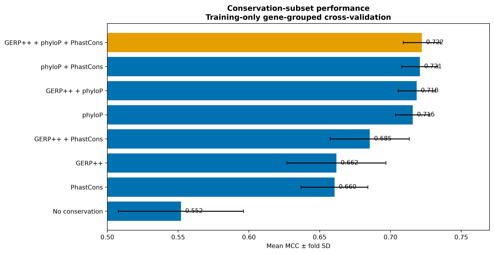
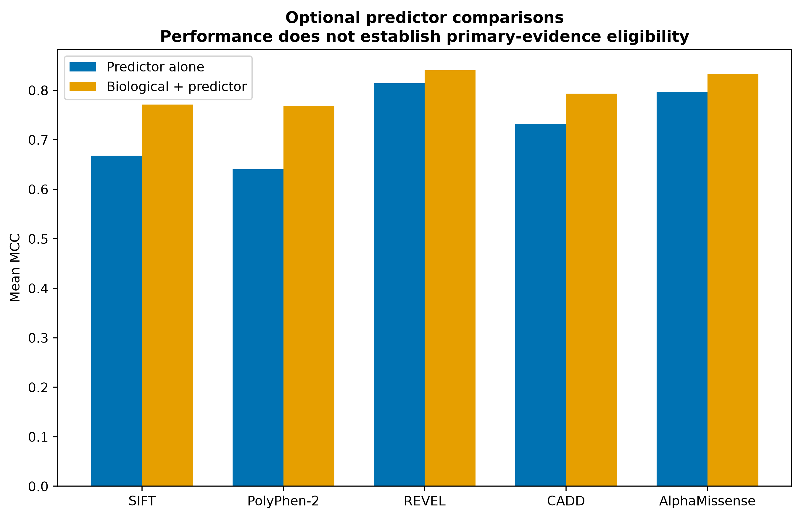
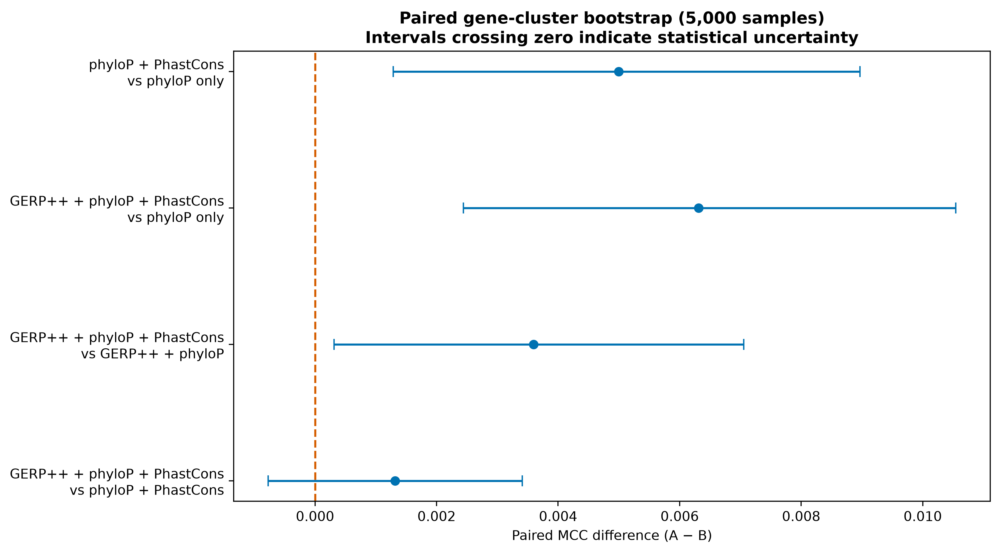
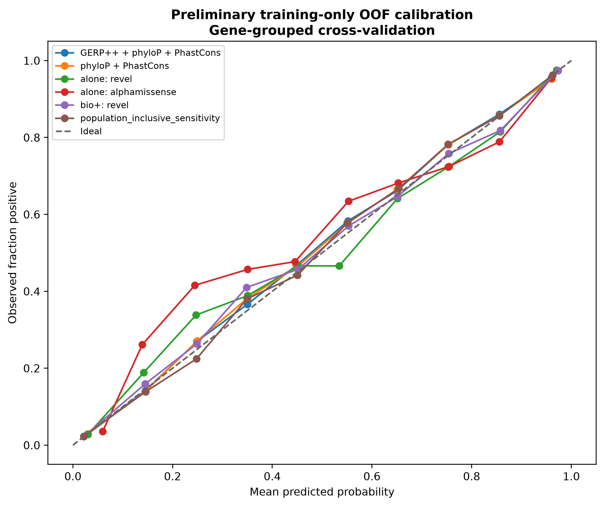

# Revised pre-modelling evidence audit

## Scope and safeguards

This report preserves the initial report and adds corrected provenance, governance, paired uncertainty and publication figures. Statistics and preliminary modelling use the 27,727-row training partition only. Aggregate validation/test counts are used only for split integrity; validation and test outcomes were not analysed. Preliminary cross-validation is not final model evaluation.

## Cohort and split

The frozen 40,000 variants reconcile to 39,552 retained variants and 448 preserved gene-mapping exclusions. Train/validation/test contain 27,727/5,790/6,035 variants and 5,206/1,115/1,115 genes. Gene overlap and variant overlap are zero.

## Corrected provenance and circularity

GERP++, phyloP, PhastCons and SIFT do not have conventional clinically labelled training-variant overlap; these checks are NOT_APPLICABLE. PolyPhen-2 HDIV uses supervised disease/divergence examples and was assessed at protein-variant level using its official public HumDiv archive. REVEL remains unverifiable for its restricted HGMD-derived pathogenic portion. CADD uses proxy labels and has UNKNOWN EXACT RELEASE locally. AlphaMissense uses population-frequency fine-tuning; ClinVar was evaluation rather than direct training. Unavailable training data do not demonstrate absence of overlap.

## Coverage

- GERP++: 99.86%
- phyloP only: 100.00%
- PhastCons: 100.00%
- SIFT: 96.98%
- PolyPhen-2: 92.24%
- REVEL: 98.28%
- CADD: 100.00%
- AlphaMissense: 99.37%

## Correlation and VIF

phyloP–PhastCons Spearman ρ was 0.82695. Flagged predictor relationships included phyloP–CADD 0.81785, SIFT–AlphaMissense −0.80127 (SIFT direction reversed), REVEL–AlphaMissense 0.81856 and CADD–AlphaMissense 0.80312. No VIF reached 10 (maximum 8.03). Correlation indicates shared information, not circularity.

## All conservation conditions

- conservation_none: MCC 0.55202, PR-AUC 0.85478, ROC-AUC 0.85617, Brier 0.15466
- GERP++: MCC 0.66185, PR-AUC 0.89907, ROC-AUC 0.90964, Brier 0.12003
- phyloP only: MCC 0.71575, PR-AUC 0.92389, ROC-AUC 0.93049, Brier 0.10369
- PhastCons: MCC 0.66049, PR-AUC 0.89750, ROC-AUC 0.90918, Brier 0.12045
- GERP++ + phyloP: MCC 0.71849, PR-AUC 0.92436, ROC-AUC 0.93148, Brier 0.10275
- conservation_gerp_rs__phastcons100way: MCC 0.68541, PR-AUC 0.90713, ROC-AUC 0.91874, Brier 0.11294
- phyloP + PhastCons: MCC 0.72082, PR-AUC 0.92569, ROC-AUC 0.93325, Brier 0.10132
- GERP++ + phyloP + PhastCons: MCC 0.72214, PR-AUC 0.92565, ROC-AUC 0.93341, Brier 0.10112

## Optional predictors and population sensitivity

- comparator_predictor_sift_score: MCC 0.66785, PR-AUC 0.88212, ROC-AUC 0.90575, Brier 0.14075
- biological_plus_predictor_sift_score: MCC 0.77101, PR-AUC 0.94152, ROC-AUC 0.94929, Brier 0.08578
- comparator_predictor_polyphen2_hdiv_score: MCC 0.64032, PR-AUC 0.86372, ROC-AUC 0.89609, Brier 0.13979
- biological_plus_predictor_polyphen2_hdiv_score: MCC 0.76808, PR-AUC 0.94019, ROC-AUC 0.94900, Brier 0.08588
- comparator_predictor_revel_score: MCC 0.81409, PR-AUC 0.96966, ROC-AUC 0.96954, Brier 0.06756
- biological_plus_predictor_revel_score: MCC 0.84002, PR-AUC 0.97229, ROC-AUC 0.97428, Brier 0.05961
- comparator_predictor_cadd_phred: MCC 0.73171, PR-AUC 0.90911, ROC-AUC 0.92990, Brier 0.10228
- biological_plus_predictor_cadd_phred: MCC 0.79330, PR-AUC 0.94997, ROC-AUC 0.95670, Brier 0.07852
- comparator_predictor_alphamissense_score: MCC 0.79677, PR-AUC 0.96017, ROC-AUC 0.96232, Brier 0.07702
- biological_plus_predictor_alphamissense_score: MCC 0.83308, PR-AUC 0.96473, ROC-AUC 0.96977, Brier 0.06225

Population-inclusive sensitivity: MCC 0.77475, PR-AUC 0.94632, ROC-AUC 0.95198, Brier 0.08350. Population evidence remains sensitivity-only because of class-associated missingness. Performance improvement does not remove circularity, so computational predictors remain comparator/sensitivity evidence.

## Paired gene bootstrap and refined interpretation

The best observed conservation condition was all three scores. phyloP + PhastCons is the parsimonious alternative. The paired MCC difference was 0.00132, 95% interval [-0.00077, 0.00341], P(diff>0)=0.888. The interval includes zero; therefore the larger condition is not claimed superior. The initial recommendation remains preserved.

## Next step

After governance review, run the refined single validation-confirmation command once. It evaluates only the refined training-only selection and does not touch test. Validation was not used here; test was not used here.
