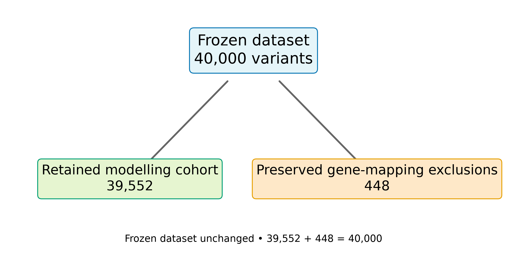
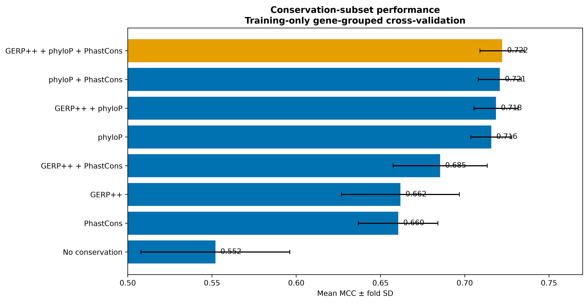
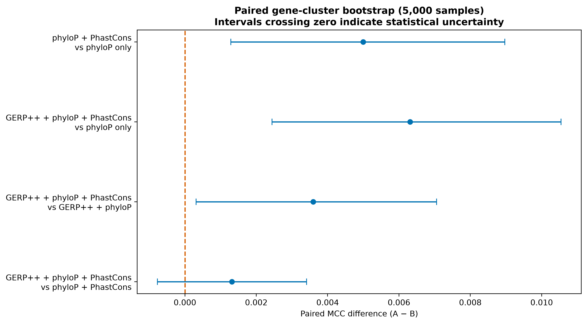

# Supervisor progress summary

## What is complete

- Verified 40,000 frozen variants, 39,552 retained, and 448 preserved exclusions.
- Confirmed zero gene/variant overlap across the locked split.
- Corrected provenance categories and tested PolyPhen-2 HumDiv overlap safely at protein level.
- Completed training-only correlations, fixed-fold experiments and 5,000-sample paired gene bootstrap.

## Main interpretation

All three conservation scores were best observed (MCC 0.72214), while phyloP + PhastCons was nearly identical (0.72082). Bootstrap 95% interval for their MCC difference: [-0.00077, 0.00341]. Because it includes zero, phyloP + PhastCons is the parsimonious alternative.

REVEL and AlphaMissense improve training CV strongly, but remain comparator/sensitivity evidence because performance cannot remove circularity or provenance concerns.

## What happens next

Review governance and the refined command, then confirm exactly one preselected configuration on validation. The test partition stays locked for final evaluation.
